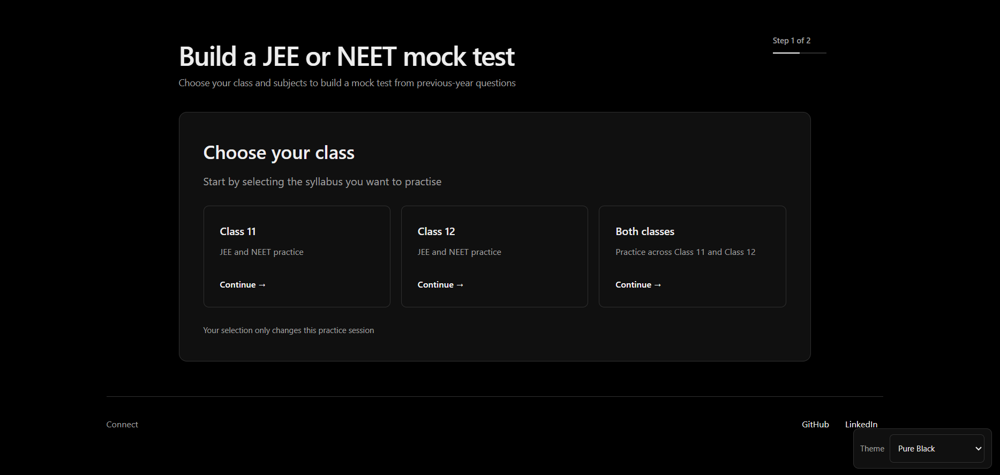
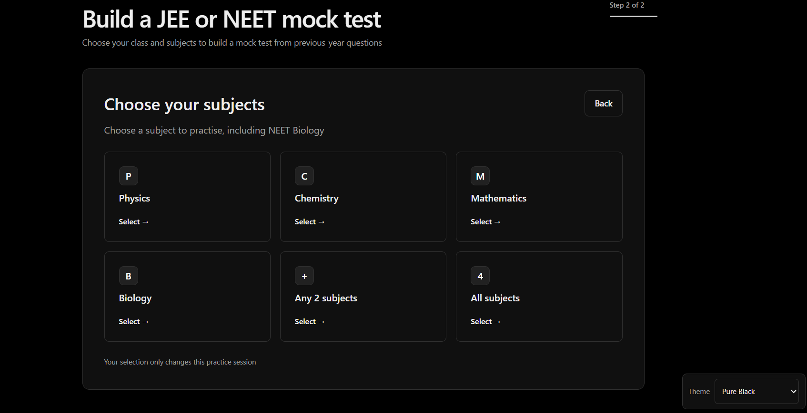
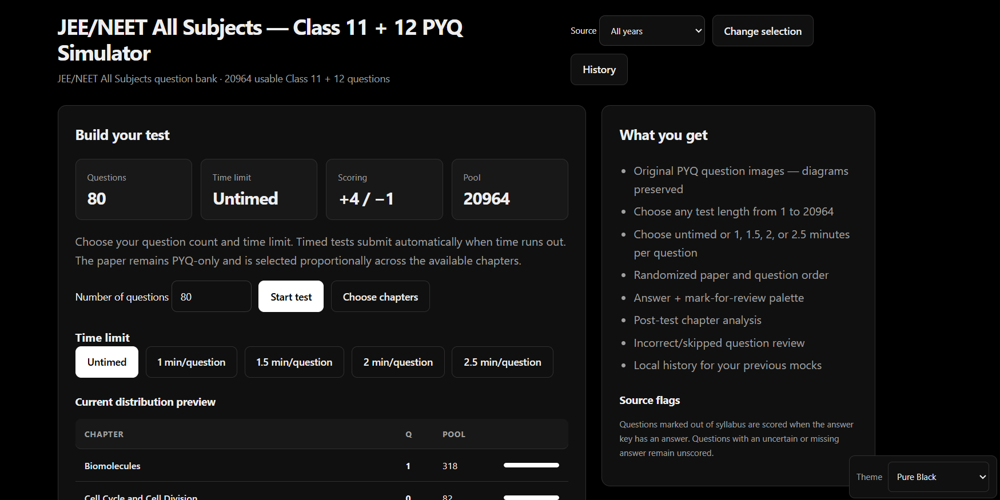
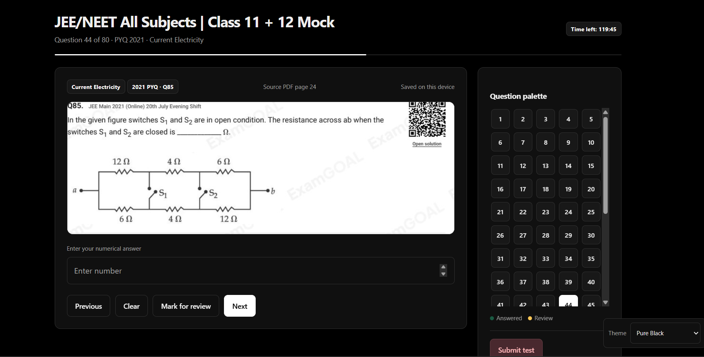
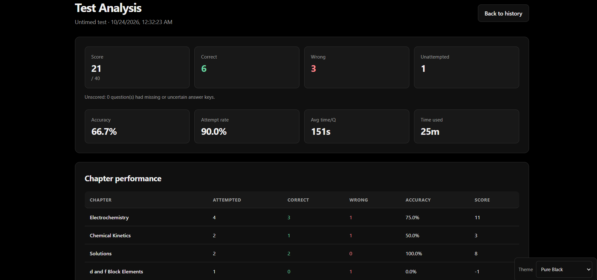
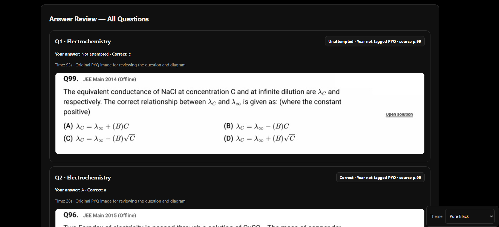

# JEE/NEET PYQ Test Generator

Build focused practice tests from image-based previous-year questions for JEE Main and NEET.

**[Open the hosted app](https://jee11testgenerator.vercel.app/)**

Choose a class, subject combination, source year, and chapters. Generate a randomized timed or untimed test, answer from the original question images, then review your score and chapter performance.

## At a glance

| Exam | Subjects |
| --- | --- |
| JEE Main | Physics, Chemistry, Mathematics |
| NEET | Biology |

Classes 11 and 12 are available, with options to combine subjects or use all available subjects.

## Features

- Build a test with a custom question count and chapter selection.
- Balance questions across selected chapters based on the available question pool.
- Filter questions by year or use all available sources.
- Set a timer or practise without one.
- Answer single-correct and multiple-correct questions, or enter numerical answers.
- Navigate with the question palette, clear answers, and mark questions for review.
- Score with the standard **+4 / -1** scheme; unscored questions do not affect the result.
- Review answers, time spent, accuracy, attempt rate, and chapter-level performance.
- Resume an active test and revisit recent results stored in the browser.
- Choose from light and dark themes.

## Screenshots

### Class selection



### Subject selection



### Test setup



### Taking a test



### Results and analysis



### Answer review



## Run locally

The app is a static site and has no build step.

```bash
git clone https://github.com/amantiwatane2009/JEE-TEST-GENERATOR.git
cd JEE-TEST-GENERATOR
python -m http.server 8000
```

Open [http://localhost:8000](http://localhost:8000). A local server keeps image paths and Supabase requests working consistently. On Windows, START_TEST.bat is also available to open the app directly.

## Question data

The browser reads questions from the Supabase public.jee_questions table and combines them with the local banks. If Supabase is unavailable, the app falls back to the locally loaded banks.

The question data expects source_file, question_id, and question columns. The browser uses a Supabase publishable key and read-only access; no service-role key belongs in the client. To connect a fork to its own Supabase project, update supabase-config.js and provide read access to the table through an appropriate Row Level Security policy. The read policy is in [supabase/migrations/20261023_public_read_jee_questions.sql](supabase/migrations/20261023_public_read_jee_questions.sql).

Printed answer keys are transcribed from source PDFs and have not all been independently re-solved. Questions with missing or uncertain keys remain unscored. Import reports record source details and review notes.

## Repository layout

```text
.
├── index.html, app.js, style.css    Static web app
├── supabase-config.js               Browser-safe project configuration
├── supabase-questions.js            Supabase loading and local fallback
├── data/
│   └── question-banks/              Local JavaScript and JSON question banks
├── assets/questions/                Question image crops
├── questions/                       Existing question image files
├── docs/
?   ??? import-qa/                   Per-import QA reports
?   ??? screenshots/                 README screenshots
└── supabase/migrations/             Database policies
```

## Credits

- Physics question PDFs: [Eduniti](https://www.youtube.com/@mohitgoenka99) — [PDF collection](https://drive.google.com/drive/folders/1785MiemoRxcc3o6dto6DKCdEfcW70gO_).
- Chemistry and Biology question PDFs: [ExamGOAL PDF Library](https://pdf.questions.examgoal.com/).

This repository is an independent practice tool. The source PDFs and their content remain attributed to their respective providers.

## Feedback

When reporting an issue, include the exam, subject, chapter, source year, and question number. For answer-key or image issues, include the corresponding import report from [docs/import-qa/](docs/import-qa/).
